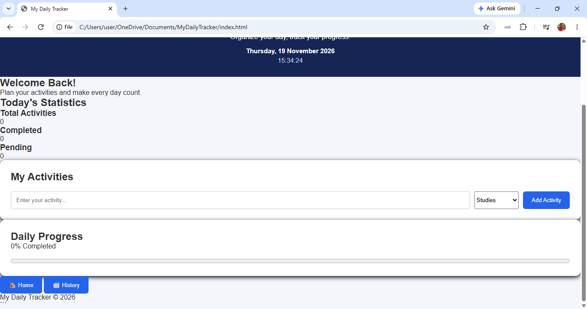

# 📅 My Daily Tracker

A personal productivity application built using HTML, CSS and JavaScript.

My Daily Tracker helps users organise daily activities, track completed tasks and monitor their daily progress.

## ✨ Features

- Add daily activities.
- Edit and delete activities.
- Mark activities as completed.
- Track daily progress.
- View activity history.
- Save activities using browser storage.

## 🛠️ Technologies Used

- HTML5
- CSS3
- JavaScript
- Local Storage

## 📸 Application Preview

## 🌐 Live Demo

[Open My Daily Tracker](https://clintonelijah-dev.github.io/my-daily-tracker/)

## 👨‍💻 Developer

Clinton Elijah  
Software Engineering Student | Aspiring Software Developer

GitHub: https://github.com/clintonelijah-dev
